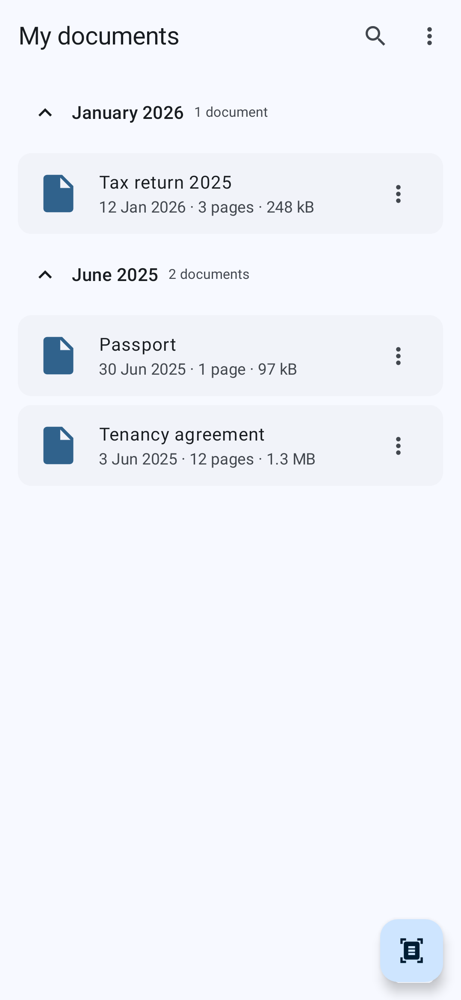
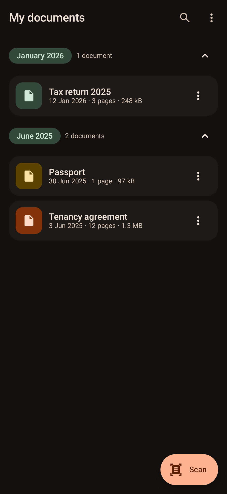
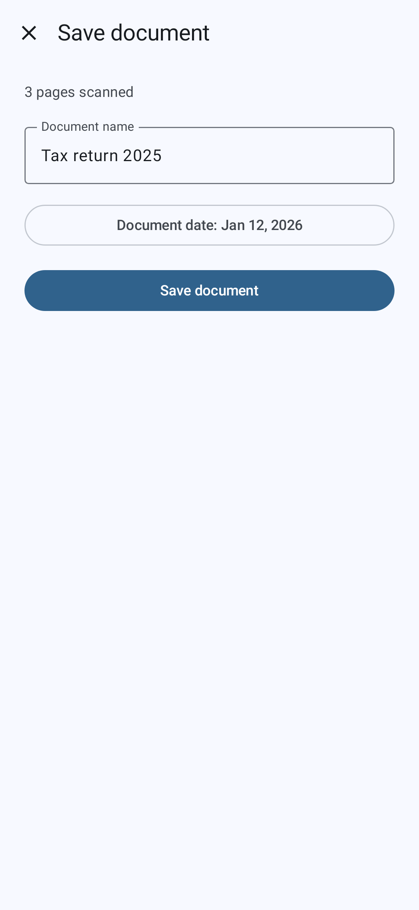

<h1 align="center">📄 CitizenDocs</h1>

<p align="center">
  Scan your paperwork, keep it on your phone, and find it again when someone asks you to prove you live where you live.
</p>

<p align="center">
  <a href="https://opensource.org/licenses/MIT"></a>
  <a href="https://android-arsenal.com/api?level=26"></a>
  <a href="https://github.com/salpiras/citizen-docs/actions/workflows/ci.yml"></a>
  
</p>

<p align="center">
  
  
  
</p>

<p align="center"><sub><i>These are the committed screenshot-test goldens, so they cannot go stale — CI fails if the app stops looking like this.</i></sub></p>

Five years of utility bills, tenancy agreements and tax letters, and the one you need is
always in the other drawer. CitizenDocs scans them with the camera, files them by month,
and keeps the lot in app-private storage. No account, no sign-in, and the whole library
exports to a ZIP whenever you want it somewhere else.

## 🚀 Features

- 📸 Scan with ML Kit — edge detection, multi-page, straight to PDF
- 🗂️ Filed into collapsible month sections, newest first
- 🔍 Search by name, with a debounced query so typing stays quick
- ✏️ Rename and delete, with the file on disk kept in step
- 📦 Export everything (or just what a search is showing) to a ZIP foldered by year and month
- 🌗 Light and dark, both hand-tuned — no wallpaper-coloured surprises
- 🔒 No account, no sign-in, no analytics. Documents live in app-private storage

> [!NOTE]
> Android Auto Backup is still on, which means the PDFs are quietly going to your Google
> Drive quota — and silently stopping at the 25 MB cap. Switching that off is part of
> landing proper Drive backup, below.

## 🧱 Architecture

Multi-module Clean Architecture with MVI screens. Dependencies point one way only, and the
module graph enforces it rather than code review — a feature module physically cannot
import a Room entity or an Android `Uri`.

- **`app`** — navigation host, `Application`, `MainActivity`
- **`feature:documents`** — the list, search, grouping and export
- **`feature:scan`** — naming and dating a fresh scan
- **`core:model`** — `Document` and its validation rules *(pure JVM)*
- **`core:common`** — dispatcher qualifiers, `Clock`, `TimeZone` *(pure JVM)*
- **`core:domain`** — use cases
- **`core:data`** — the repository that keeps the row and the file in agreement
- **`core:database`** — Room
- **`core:storage`** — files and `FileProvider`
- **`core:scanner`** — ML Kit, wrapped so nothing above it imports Google
- **`core:drive`** — the Drive client, wrapped the same way
- **`core:designsystem`** — theme, motion, shared components
- **`core:ui`** — MVI base, `DocumentCard`
- **`core:testing`** — fakes and fixtures
- **`benchmarks`** — baseline profile and startup macrobenchmark

Every screen is a stateless `…Screen` under a stateful `…Route`. One `StateFlow`, one
`onEvent(Event)`, and a `Channel` for the things that should not replay on rotation.

## 🛠️ Tech stack

- [Kotlin](https://kotlinlang.org/) 2.3 with [Coroutines](https://github.com/Kotlin/kotlinx.coroutines) and Flow
- [Jetpack Compose](https://developer.android.com/compose) and Material 3, with type-safe [Navigation](https://developer.android.com/guide/navigation)
- [Hilt](https://dagger.dev/hilt/) for dependency injection, via [KSP](https://github.com/google/ksp)
- [Room](https://developer.android.com/training/data-storage/room) for metadata, app-private files for the PDFs
- [ML Kit Document Scanner](https://developers.google.com/ml-kit/vision/doc-scanner) for the camera
- [Roborazzi](https://github.com/takahirom/roborazzi) and [Robolectric](https://robolectric.org/) for screenshots, [Turbine](https://github.com/cashapp/turbine) and [Truth](https://truth.dev/) for the rest
- AGP 9 with built-in Kotlin, and convention plugins in `build-logic`

## ▶️ Running it

```bash
git clone https://github.com/salpiras/citizen-docs.git
./gradlew installDebug
```

## 🧪 Testing

The whole suite runs on the JVM. No emulator, no connected device.

```bash
./gradlew testDebugUnitTest test   # unit, behaviour and screenshot tests
./gradlew spotlessApply lint       # format and lint
```

Screenshot goldens live next to the code they cover and are committed. Re-record them after
an intentional UI change:

```bash
./gradlew recordRoborazziDebug
```

They allow a 1% pixel difference, which absorbs the anti-aliasing drift between recording on
macOS and verifying on Linux CI without hiding any real change.

The one exception to the no-device rule is `:benchmarks`, which generates the committed
baseline profile and measures startup:

```bash
./gradlew :app:generateBaselineProfile
```

## 🔘 What's next

- [ ] Back up and restore through Google Drive — documents have stable ids and there's a Drive client, the UI is still to come
- [ ] Turn off Android Auto Backup once Drive lands, so the PDFs aren't uploaded twice
- [ ] OCR, so search looks inside documents and not just at their names
- [ ] Tags, for the papers that don't belong to a single month
- [ ] A document detail screen, which would finally make a shared-element transition worth having

## 📄 License

MIT. See [LICENSE](LICENSE).
